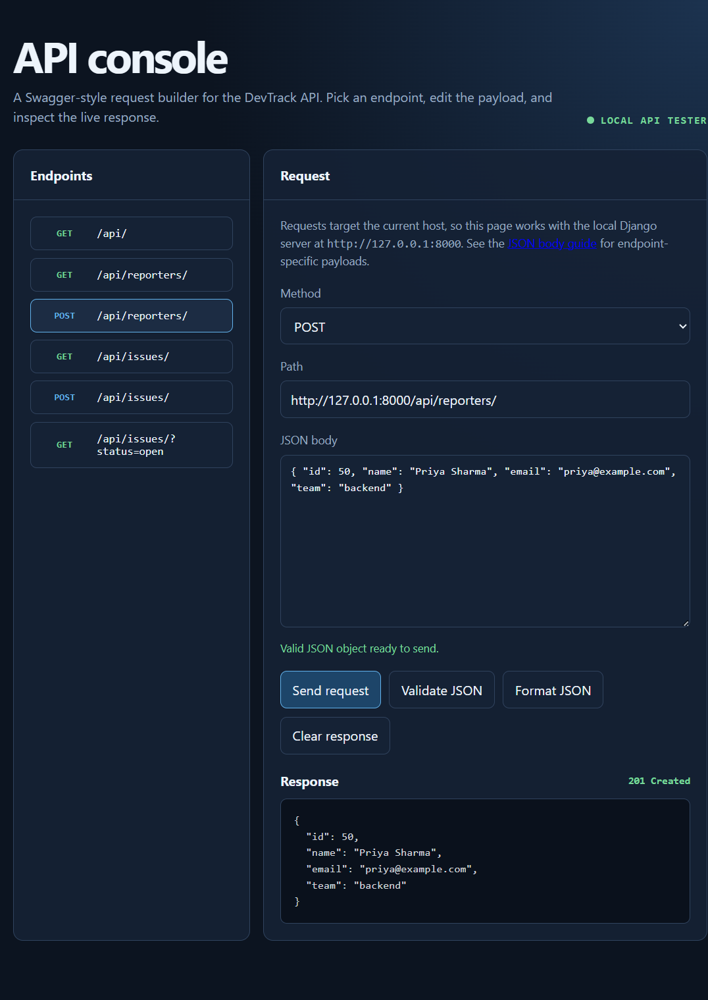
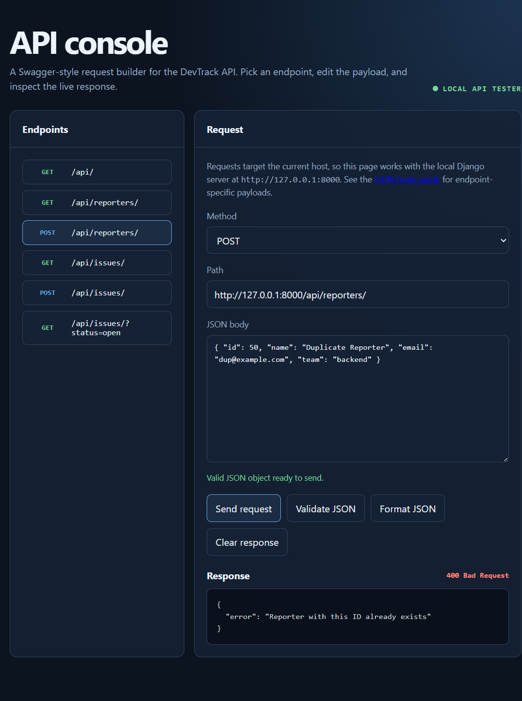
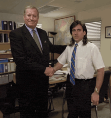
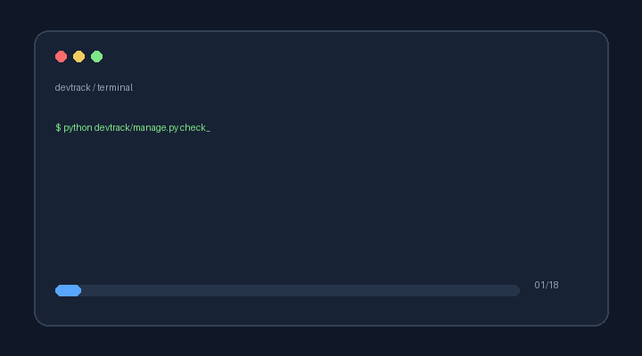
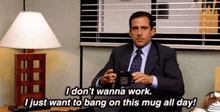
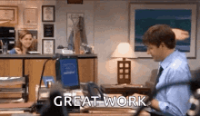
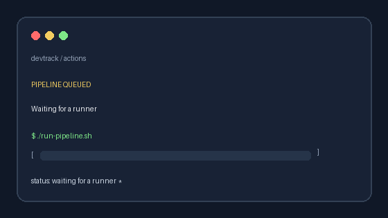
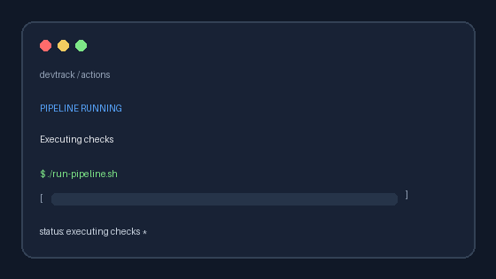
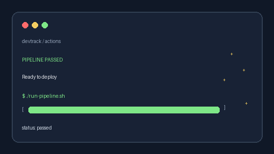

# Screenshots

Evidence of successful and failing API requests, captured with the local [API console](../../docs/api-console.html) against the running Django dev server.

- `postman-success.png` — `POST /api/reporters/` returning `201 Created`
- `postman-failure.png` — `POST /api/reporters/` with a duplicate `id` returning `400 Bad Request` (`Reporter with this ID already exists`)

Use the [pipeline status board](../../docs/status-board.md) to connect API screenshots with their workflow run. Expand a run, click a test stage to load its inline log, and open the full GitHub job log when a scenario fails.

## Project GIF gallery

