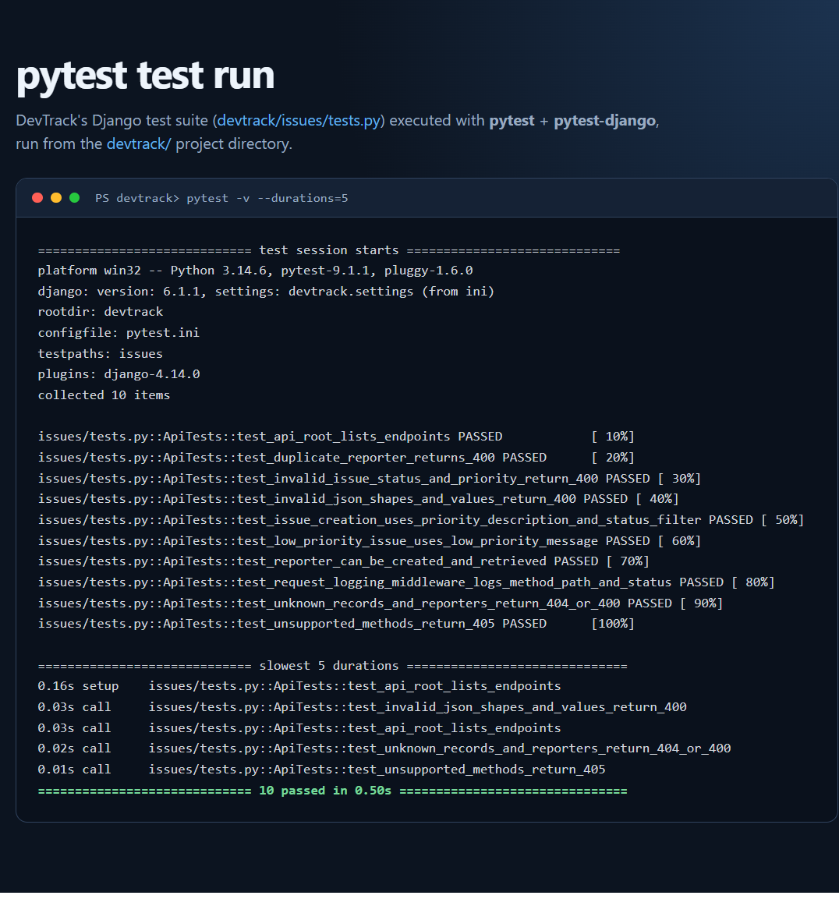

# Testing & pytest

DevTrack's test suite lives in [`devtrack/issues/tests.py`](../devtrack/issues/tests.py) and is written with Django's standard `TestCase`. It can be run two ways:

- **`python manage.py test`** — Django's built-in test runner. Used by every CI workflow ([pull-request-tests.yml](../.github/workflows/pull-request-tests.yml), [app-deploy.yml](../.github/workflows/app-deploy.yml), [extended-tests.yml](../.github/workflows/extended-tests.yml)).
- **`pytest`** — a faster, more informative local runner via the [`pytest-django`](https://pytest-django.readthedocs.io/) plugin. Useful for day-to-day development: better failure output, test selection (`-k`), and `--durations` to spot slow tests.

Both runners execute the exact same 10 test cases — nothing is duplicated or rewritten for pytest.

## How pytest is wired up

- [`devtrack/pytest.ini`](../devtrack/pytest.ini) points pytest at the Django settings module and the `issues` app:

  ```ini
  [pytest]
  DJANGO_SETTINGS_MODULE = devtrack.settings
  python_files = tests.py test_*.py *_tests.py
  testpaths = issues
  addopts = --import-mode=importlib
  ```

- `--import-mode=importlib` avoids a package-name collision: the project nests a `devtrack/` package inside a `devtrack/` directory, so pytest's legacy import mode would try to resolve `devtrack.issues.tests` against the wrong path. `importlib` mode collects tests by file path instead, side-stepping the clash.
- `pytest-django` boots Django (via `DJANGO_SETTINGS_MODULE`) before collecting tests, so `TestCase`, the test client, and fixtures all behave exactly as they do under `manage.py test`.

## Running it locally

From the `devtrack/` project directory (where `manage.py` and `pytest.ini` live):

```powershell
pip install -r requirements.txt
cd devtrack
pytest -v
```

Useful flags:

```powershell
pytest -v --durations=5   # show the 5 slowest tests
pytest -k duplicate       # run only tests matching "duplicate"
pytest -s                 # show print() output, e.g. the SCENARIO logs
```

## Sample run



All 10 tests pass, including:
- the 9 API scenario tests (reporter/issue CRUD, validation, 404/400/405 handling)
- `test_request_logging_middleware_logs_method_path_and_status`, which asserts the [`RequestLoggingMiddleware`](../devtrack/issues/middleware.py) logs every request

## Evidence of real requests

For end-to-end proof beyond unit tests, [`devtrack/screenshots/`](../devtrack/screenshots/README.md) also contains screenshots of a successful and a failing request captured against the live dev server with the [API console](api-console.html).
